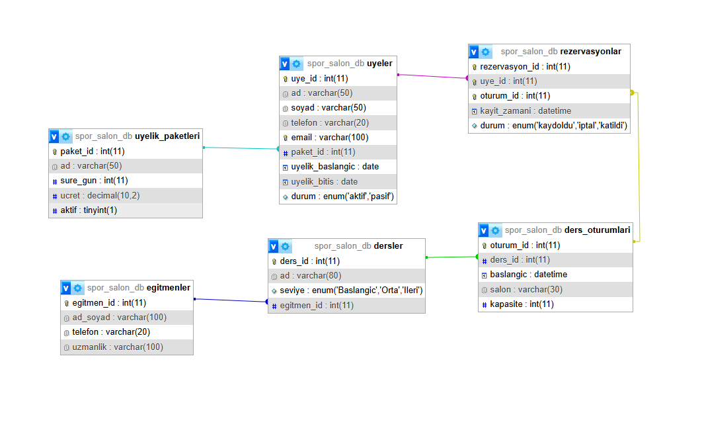

# Gym Management System (PHP + MySQL)

Web application for managing a gym: members, membership packages, instructors, class sessions and reservations with capacity control.

## Features

- Member list and member registration with membership package selection
- Class sessions with instructor, room, start time and capacity
- Reservations with remaining-capacity check (prevents overbooking)
- Relational schema with foreign keys (`ON DELETE CASCADE / SET NULL`)

## Setup

1. Install XAMPP (or any PHP 8 + MySQL/MariaDB stack).
2. Import `spor_salon_db.sql` into MySQL (creates `spor_salon_db` with sample data).
3. Copy the project into `htdocs/` and adjust credentials in `db.php` if needed.
4. Open `http://localhost/gym-management-php-mysql/`.

## Tech stack

PHP (mysqli, prepared statements) · MySQL · HTML

Sample data is fictional. UI text is in Turkish.
